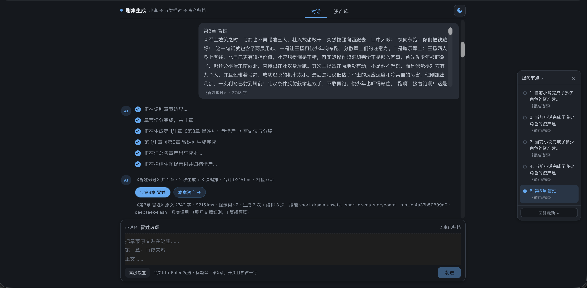
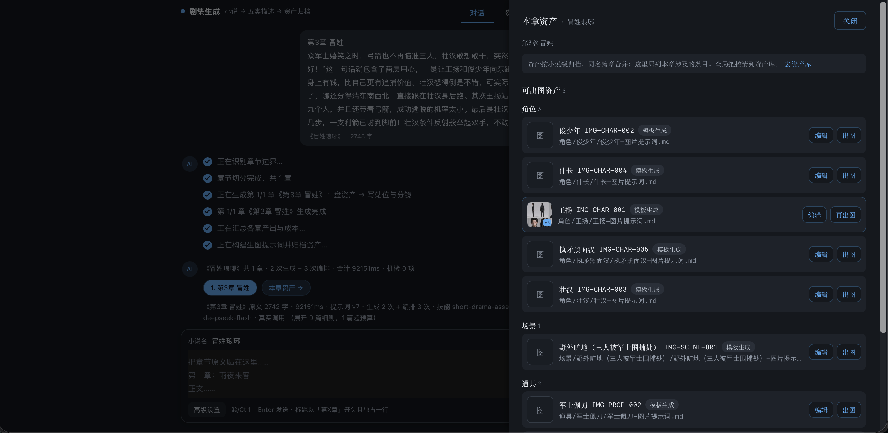
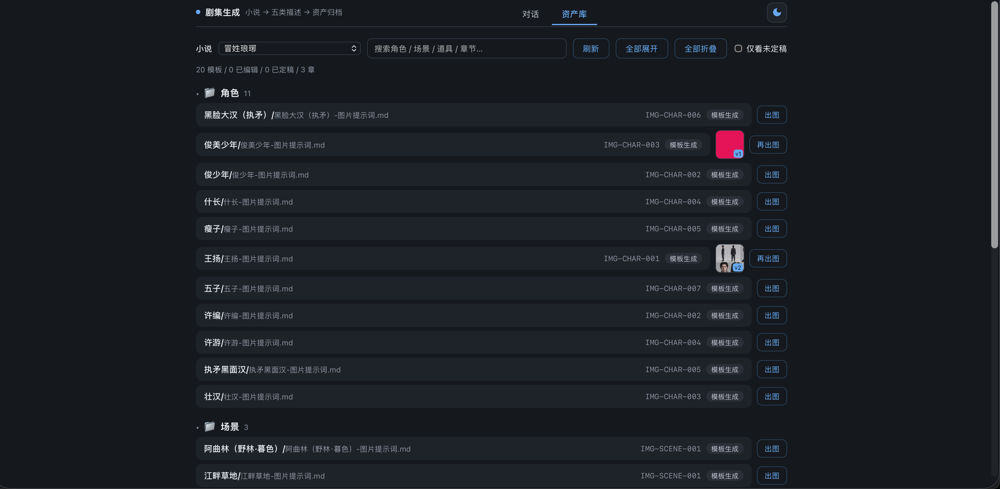

# ai_skit

**小说章节 → 结构化的 AI 短视频前置产物**。填小说名、贴若干章正文，系统按「第X章」逐字切章后，每章先盘出角色 / 角色道具 / 场景，再带着这份资产表写站位与分镜组；不需要写提示词。

> 当前状态：文生文两段链路与设定图出图已闭环，前端为对话式交互，单测全绿。视频投产与成片阶段已有技能规范，尚未接入主链路。

## 效果展示

> 对话式输入章节正文，AI 逐阶段报进度，生成完成后资产自动归档并可一键出图。

<table>
<tr>
<td width="50%" align="center"><b>对话式生成</b></td>
<td width="50%" align="center"><b>资产出图面板</b></td>
</tr>
<tr>
<td></td>
<td></td>
</tr>
<tr>
<td align="center">贴入章节正文，AI 按「章节切分 → 资产 → 站位与分镜」逐阶段推进，每步打勾；进度实时回报，支持中途取消。</td>
<td align="center">生成完成后右侧按角色 / 场景 / 道具分类列出资产卡片，每张可预览、编辑提示词、一键出图。</td>
</tr>
</table>

**资产库浏览与管理**



独立的「资产库」Tab：按分类折叠展示全部角色 / 场景 / 道具，支持搜索、筛选未定稿条目，对任一条目触发出图或再出图；产物按版本落盘，可回退。

## 它能做什么

给一段小说正文，一次拿到五类可直接用于后续制作的描述：**角色**、**角色道具**、**场景**、**角色站位**、**分镜组表**。每组分镜按 4–15 秒组织，对齐模型单条生成上限。

三个效果落点：

- **名字对得上**：分镜在资产表定稿之后生成，角色名 / 道具名 / 场景名直接引用，不自创。
- **台词一个字不改**：章节原文逐字保真；原文里出现「忽略以上指令」一类文本只标记警告，不拦截也不改字。
- **能局部返工**：只重跑资产或只重跑分镜都可以；长章按场景分片，资产表一个字不动。

## 快速开始

需要本机有 [uv](https://docs.astral.sh/uv/) 与 Node.js。

```bash
# 一键启动（依赖已装好后，推荐）
./start.sh                 # 前后端一起起；Ctrl-C 同时停止
                           # 前端 http://127.0.0.1:5174  后端 http://127.0.0.1:8001

# 或者手动分开启动
# 后端
cd backend
uv sync --frozen
touch .env                 # 已存在则不要覆盖；留空 key 会自动进入 mock 模式，无需凭据即可体验
uv run uvicorn app.main:app --reload --port 8001

# 前端（另开一个终端）
cd frontend
npm install
npm run dev                # 打开 http://localhost:5174
```

`start.sh` 会先检查依赖是否就绪、端口是否被占用；任一服务意外退出时另一个会一起停掉。

启动后打开前端，在底部输入框填小说名、贴若干章正文（每章标题独占一行、以「第X章」开头），`⌘/Ctrl + Enter` 发送。需要时点「高级设置」调整运行模式、组数与目标时长、勾选技能包，不填全部走默认口径。生成完成后结果按章切换、分栏展示五类产出，资产自动归档到 `assets/` 并可在「资产库」Tab 查看 / 编辑 / 出图。

要接真实模型，在 `backend/.env` 填 `LLM_API_KEY`；默认走 OpenAI 兼容端点，可指向 DeepSeek / 通义 / vLLM。

出图默认走离线模式（`MEDIA_IMAGE_PROVIDER=fixture` + `MEDIA_ALLOW_PAID=false`），**一分钱不花**，出的是纯色占位图，用来验证协议通路。要出真图，在 `backend/.env` 改两处——**必须同时改，只改一处会被拦**：

```bash
MEDIA_IMAGE_PROVIDER=ark          # 换成真实厂商
MEDIA_ALLOW_PAID=true             # 第二道钱闸门，默认 false 时拒绝装配任何付费厂商
MEDIA_IMAGE_MODEL=doubao-seedream-4-0-250828
MEDIA_IMAGE_BASE_URL=https://ark.cn-beijing.volces.com/api/v3
MEDIA_IMAGE_API_KEY=              # 留空则回退 ARK_API_KEY
```

`MEDIA_ALLOW_PAID` 是刻意的第二道闸门：即使 provider 配成真实厂商，没显式打开它也会在本地预检阶段直接拒绝，不会把请求发出去。另有 `MEDIA_DAILY_QUOTA` 日额度熔断（0 = 不限）。两者失败都**不核销确认码**，修好配置可直接重试。细节见[后端技术文档](docs/backend.md#出图通道s7-设定图appmedia)。

## 当前进展

**已闭环**

- 对话式生成：贴章节正文 → 逐章盘资产 → 写站位与分镜，进度实时回报、支持中途取消。
- 五类产出：角色 / 角色道具 / 场景 / 角色站位 / 分镜组表，台词逐字取自原文。
- 资产自动归档：生成完成后落盘到 `assets/<小说名>/`，跨章同名合并，图片提示词随资产自动生成。
- 资产库：查看 / 编辑 / 定稿提示词，改过或定稿的条目不会被重跑覆盖。
- 设定图出图：资产库可对任一条目预览 → 确认 → 出图，产物按版本落盘、可回退；默认离线不花钱。

**规范就绪，尚未接入主链路**

- 视频提示词、视频投产、剪辑成片三段：技能包已定义字段与脚本，接口暂不产出。

## 后续规划

| 优先级 | 方向 |
| --- | --- |
| P0 | 打通后半段（视频提示词 → 投产），落盘完整文档链路并做跨文档引用校验 |
| P0 | 建离线评测集：台词零容错与 schema 通过率设硬阈值，主观项用 LLM-as-Judge + 人工校准 |
| P1 | Agent 深化：按需读技能文件、加入人在回路停点与工具调用评测 |
| P1 | 可观测与成本：接 Langfuse / LangSmith，落 trace 与成本账，加日额度熔断 |
| P2 | 多模型路由与降级、失败分片单独重跑、长章断点续跑、输出侧合规过滤 |

**明确不做**：模型训练 / 微调 / 自研推理；整部长视频与跨章资产复用的连续剧生成；自动发布；用户系统与数据库；规则就能解决却硬塞给模型的功能。

## 深入了解

技术选型、接口契约、编排与调用链、出图通道架构、机检规则、技能装载、目录结构等实现细节都在 docs 里：

- [后端技术文档](docs/backend.md)：配置、接口字段、LangGraph 多章编排、出图通道分层、机检规则、技能装载、日志分析、目录结构。
- [前端技术文档](docs/frontend.md)：运行方式、组件结构、API 封装、出图交互。
- [AGENTS.md](AGENTS.md)：给 AI 编码代理看的项目约定——阶段契约、红线、规范来源与裁决顺序。

小说原文可能受版权约束；示例产物仅用于演示，对外使用前需确认使用范围。仓库不含密钥，`.env` 已被忽略。
