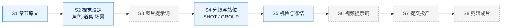
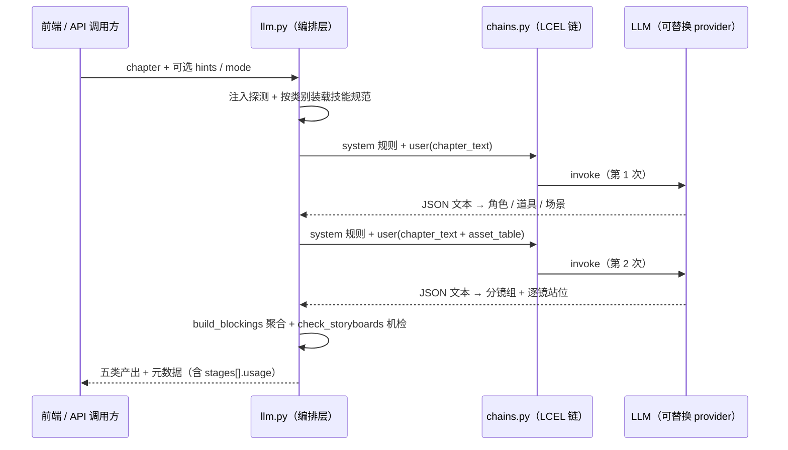

# ai_skit

**小说章节 → 结构化的 AI 短视频前置产物**。贴一段小说正文，后端按技能规范先盘出角色 / 道具 / 场景，再带着这份资产表写站位与分镜组；用户不需要写提示词。

技术栈：Python 3.12 · FastAPI · LangChain 1.x · Vue 3 + Vite + TypeScript · uv · 12 个可替换的 Agent Skills。

> 当前状态：**文生文两段链路已闭环**（资产段 → 分镜段，含代码机检），前端可交互，113 个单测全绿。图片提示词 / 视频提示词 / 投产 / 成片阶段已有技能规范与脚本，但尚未接入主链路，见下方「实现阶段」。

## 它解决什么问题

把小说改成短视频，难的从来不是调用模型，而是**让几十个产物互相一致**：分镜里的角色名不能和设定图对不上，站位不能和镜头矛盾，台词一个字都不能改。这个项目把这些约束拆成可核查的阶段，并用规则而非模型去守能算的那部分。

三个具体落点：

- **名字一致性**：分镜是第二段生成的，但它能看到第一段的完整资产表（作为 `<asset_table>` 注入 user），所以角色名 / 道具名 / 场景名不会自创。
- **台词零容错**：章节原文是不可信输入、逐字保真；若原文里出现「忽略以上指令」一类文本，只标记 `injection_warning`，不拦截也不改字。
- **可返工**：`assets_only` 只重跑资产，`visual_only` 只重跑分镜。长章按 `scene_filter` 分场拆，资产表一个字不动。

## 端到端链路

五类产出各自来自哪一段，一图看清：




蓝色是接口已跑通的能力（视觉设定 → 分镜与站位 → 机检，对应 S1/S2/S4/S5 的规则层）；灰色虚线是技能包已定义规范与脚本、但主链路尚未接线的阶段。接口跳过 S3 是因为当前产物是 JSON 描述而非图片文件。

### 文生文两段调用



两次调用不是重复：第一段定名字，第二段引用名字；同一条 LCEL 链复用，只有 messages 与 config 不同。

## 文生文通道（LangChain）

| 层 | 文件 | 职责 |
| --- | --- | --- |
| 规则层 | `backend/app/prompts.py` | 两套 system 用 `ChatPromptTemplate`（jinja2）渲染；`PROMPT_VERSION = v7` |
| 通道层 | `backend/app/chains.py` | 模型工厂（`LLM_PROVIDER` 驱动）、dict → Message 映射、`RunnableConfig`（超时 / 重试 / 标签 / 并发）、`UsageCollector`（token 按阶段归因） |
| 编排层 | `backend/app/llm.py` | 消息组装、两段串行、mock、Pydantic 校验、响应元数据 |

一条链是 `dict 消息 → SystemMessage/HumanMessage → ChatModel → 纯文本`。单次走 `invoke`，`per_type` 走 `batch`（并发上限 `LLM_MAX_CONCURRENCY`）。每次调用带 `run_name` / `tags` / `metadata`，接 LangSmith / Langfuse 不需改业务代码。

四条刻意的设计取舍：

1. **章节原文不进模板引擎**。它属不可信输入、逐字零容错，由编排层直接拼进 user；只有项目自己维护的 system 规则走 jinja2。技能正文作为变量值传入，含 `{{ }}` 也不会被二次解析。
2. **不用 `with_structured_output`**。输出契约仍是「JSON 文本 → 容错解析 → Pydantic 强校验」；DeepSeek 等兼容端点对 function calling 支持参差，换契约会让模型直接不可用。
3. **规则能算的不交给模型**。组时长与镜时长自洽、单镜过短、组超 15 秒由 `check_storyboards()` 代码判定，作为 `gate_issues` 回告；镜数不设上下限，避免逼模型注水或砍戏。
4. **技能包可整体替换**。12 个技能遵循 Agent Skills 开放规范（`SKILL.md` + `references/`），从 GitHub 拿来的目录可直接拷入。自动装载只认显式声明（`metadata.applies-to` / `skill-bindings.yaml`），不靠描述关键词猜。

## 快速开始

需要本机有 [uv](https://docs.astral.sh/uv/) 与 Node.js。

```bash
# 后端
cd backend
uv sync --frozen
touch .env                 # 已存在则不要覆盖；留空 key 会自动进 mock 模式
uv run uvicorn app.main:app --reload --port 8000

# 前端（另开一个终端）
cd frontend
npm install
npm run dev                # http://localhost:5173，/api 已代理到 8000
```

要接真实模型，在 `backend/.env` 填 `LLM_API_KEY`（键名与默认值见 `backend/README.md`，本仓库不含任何密钥）。默认配置走 OpenAI 兼容端点，`LLM_BASE_URL` 可指向 DeepSeek / 通义 / vLLM；换其它 provider 需另装对应 LangChain 集成包。

试一下：

```bash
curl -s localhost:8000/api/pipeline/generate \
  -H 'Content-Type: application/json' \
  -d '{"chapter":"林桂芳推开老饭馆的木门，铜钥匙在掌心攥得发烫。","mode":"auto"}' | head -c 1200
```

## API

| 方法 | 路径 | 说明 |
| --- | --- | --- |
| GET | `/api/health` | 健康检查 |
| GET | `/api/pipeline/skills?categories=characters,scenes` | 技能菜单（仅元数据，供前端勾选） |
| POST | `/api/pipeline/generate` | 主路径，出五类 |
| POST | `/api/pipeline/extract-assets` | 兼容别名 |

请求体只需 `chapter`，其余可选：`character_hint` / `prop_hint` / `scene_hint`、`mode`、`target_duration`、`max_groups`、`skills`、`assets`、`scene_filter`。

`mode` 四种：

| 模式 | 调用次数 | 用途 |
| --- | --- | --- |
| `auto`（默认） | 2 | 两段串行，出全五类 |
| `assets_only` | 1 | 只出资产，返修资产时省一半 |
| `per_type` | 3 | 三类并发隔离，用于验证「一起出会不会串味」；不出站位与分镜 |
| `visual_only` | 1 | 带回资产表只重跑分镜；配合 `scene_filter` 做长章分场 |

响应是五类平铺 `characters` / `props` / `scenes` / `blockings` / `storyboards`，加 `prompt_version` / `mode` / `llm_calls` / `skills_*` / `stages`（含 `usage`）/ `gate_issues` / `total_groups_estimated` / `truncated` 等元数据。

> 长章注意：一次调用最多输出 20 组。实测 4542 字的一章模型自估 22–55 组，不分场就只拍得到开头。解决办法是 `scene_filter` 分场，不是调大 `max_groups`。

## 实现阶段

### 已完成

- **接口与前端闭环**：FastAPI 三个接口 + Vue 3 页面，可输入章节、勾选技能、切换模式、查看五类结果与机检提示。
- **文生文两段链路**：资产段与分镜段串行，站位由分镜聚合而非单独生成。
- **LangChain 通道迁移**：提示词渲染结果有逐字等价回归（`tests/unit/prompt_baseline_v7.py`），证明换载体不改正文。
- **技能加载器**：扫描 `SKILL.md`、解析通用 frontmatter、`references/` 内联展开（两层、带预算）、类别自动装载。
- **代码门禁**：时长算术与镜长规则、Pydantic 字段校验、`gate_issues` 回告。
- **工程化**：uv 锁定 3.12 与 60 个依赖；113 个单测 + ruff 全绿；token 按阶段归因。

### 规范就绪，尚未接入主链路

- S3 图片提示词（`IMG-...`）、S6 视频提示词（`MOTION-...` / `GROUP-...`）：技能包已定义字段与规则，接口暂不产出这两类文档。
- S7 投产：技能包内已有 `seedance` / `minimax-h3` 适配器与 `prepare → confirm → run` 三步流程，但未接进 API；投产需要真实凭据与计费额度。
- S8 成片：`剪辑单.md`、顺序拼接、`trace.jsonl` / `cost.json` 尚未实现。
- 文档落盘：目前五类产出以 JSON 响应返回；仓库约定的 `剧本.md` / `视觉设定.md` / `分镜.md` 等落盘文档链路尚未由接口自动写出。

### 后续规划

| 优先级 | 方向 | 具体做什么 |
| --- | --- | --- |
| P0 | 打通后半段 | 把 S3 → S6 接进接口，落盘五份文档；分镜镜号与资产条目的引用做跨文档校验 |
| P0 | 评测体系 | 建离线评测集（多题材 / 长短章 / 多角色 / 无场景描写），台词零容错与 schema 通过率设硬阈值；主观项用 LLM-as-Judge + 人工校准 |
| P1 | Agent 化 | 引入 tool calling 与 `read_file`，把 `references/` 内联展开换成真按需读取；用 LangGraph 管有状态编排与人在回路停点 |
| P1 | 可观测与成本 | 接 Langfuse / LangSmith；落 `trace.jsonl` 与 `cost.json`；按 run 核算 token 与投产费用，加日额度熔断 |
| P2 | 鲁棒性 | 多模型路由与降级；失败分片单独重跑；输出侧合规过滤 |
| P2 | 产品化 | 长章分片的进度与断点续跑；成片预览与剪辑单生成 |

### 明确不做

模型训练 / 微调 / 自研推理；多章节连续剧与长视频；自动发布；用户系统与数据库；规则就能解决却硬塞给模型的功能。

## 目录结构

```
ai_skit/
├── AGENTS.md                # 给 AI 编码代理看的项目约定（流程与契约的唯一权威）
├── backend/
│   ├── app/
│   │   ├── prompts.py       # 规则层：system 模板 + 输出契约
│   │   ├── chains.py        # 通道层：模型工厂 + LCEL + 回调
│   │   ├── llm.py           # 编排层：两段串行 + 校验 + mock
│   │   ├── schemas.py       # Pydantic 契约 + 机检函数
│   │   ├── skills.py        # 技能加载器
│   │   ├── config.py        # 配置（唯一配置文件 backend/.env）
│   │   └── routers/         # API 路由
│   ├── skills/              # 12 个 short-drama-* 技能包
│   ├── skill-bindings.yaml  # 技能 → 类别绑定表
│   └── tests/               # 113 个单测 + 手工试跑脚本
└── frontend/                # Vue 3 + Vite 最小闭环
```

各子目录有更细的说明：`backend/README.md`（配置、机检规则、技能规范、命令）、`frontend/README.md`。

## 验证

```bash
cd backend
uv run python -m unittest discover -s tests   # 113 tests OK
uv run ruff check app tests                   # All checks passed
```

`creator_markdown_check.py` 是技能包自带的跨文档机检，文档齐备后应作为交付硬门禁；当前主链路尚未产出那五份文档，因此只用于技能侧校验。

## 安全与隐私

- 仓库内没有密钥。`backend/.env` 是唯一配置文件，已被忽略且从未进入 git 历史；空 key 自动走 mock。
- `.idea/`、`.workbuddy/`、`frontend/node_modules/` 由仓库根 `.gitignore` 排除，不依赖本机全局配置。
- 章节原文按不可信输入处理：与指令分隔、不进模板引擎、不改字。
- 小说原文可能受版权约束；示例产物仅用于演示，对外使用前需确认使用范围与数据出境策略。

本仓库暂未指定统一许可证；各技能包在 `SKILL.md` frontmatter 中各自声明 `license`。
