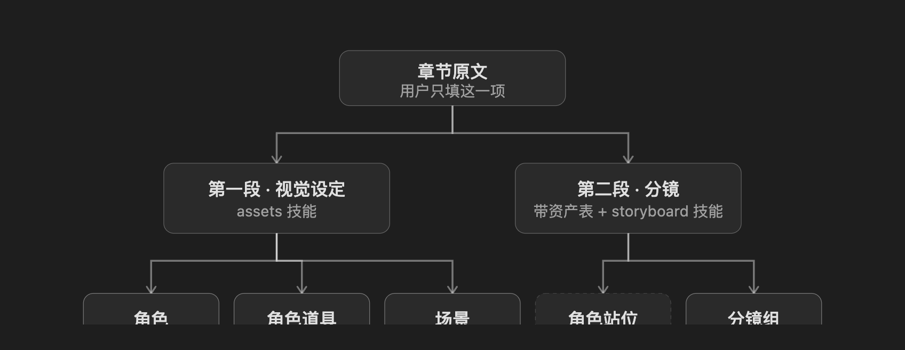

# ai_skit

**小说章节 → 结构化的 AI 短视频前置产物**。填小说名、贴若干章正文，系统按「第X章」逐字切章后，每章先盘出角色 / 角色道具 / 场景，再带着这份资产表写站位与分镜组；不需要写提示词。

技术栈：Python 3.12 · FastAPI · LangChain 1.x · Vue 3 + Vite + TypeScript · uv · 12 个可替换的 Agent Skills。

> 当前状态：**文生文两段链路已闭环**（资产段 → 分镜段，含代码机检），前端可交互，124 个单测全绿。图片提示词 / 视频提示词 / 投产 / 成片阶段已有技能规范与脚本，尚未接入主链路。

## 它能做出什么

给一段小说正文，一次拿到五类可直接用于后续制作的描述：**角色**、**角色道具**、**场景**、**角色站位**、**分镜组表**。每组分镜按 4–15 秒组织，对齐模型单条生成上限。

三个效果落点：

- **名字对得上**：分镜在资产表定稿之后生成，角色名 / 道具名 / 场景名直接引用，不自创。
- **台词一个字不改**：章节原文逐字保真；原文里出现「忽略以上指令」一类文本只标记警告，不拦截也不改字。
- **能局部返工**：只重跑资产或只重跑分镜都可以；长章按场景分片，资产表一个字不动。

## 产出流程




蓝色是当前已跑通的部分；灰色虚线是技能包已有规范与脚本、但尚未接进主链路的阶段。

## 快速开始

需要本机有 [uv](https://docs.astral.sh/uv/) 与 Node.js。

```bash
# 后端
cd backend
uv sync --frozen
touch .env                 # 已存在则不要覆盖；留空 key 会自动进入 mock 模式，无需凭据即可体验
uv run uvicorn app.main:app --reload --port 8000

# 前端（另开一个终端）
cd frontend
npm install
npm run dev                # 打开 http://localhost:5173
```

要接真实模型，在 `backend/.env` 填 `LLM_API_KEY`；默认走 OpenAI 兼容端点，`LLM_BASE_URL` 可指向 DeepSeek / 通义 / vLLM。

## 怎么用

1. 打开前端页面，填小说名，在输入框贴若干章正文（每章标题独占一行、以「第X章」开头；「序章/楔子/番外」这类惯用节名和前面带的 `📖`、`##` 也能识别）。
2. 需要时展开「高级设置」：给角色 / 道具 / 场景分别补一句要求，选运行模式，调整组数与目标时长，勾选要装载的技能包。不填全部走默认口径。
3. 点击生成，页面顶部按章切换，每章分栏展示五类结果，并回告注入警告、机检提示、失败项。
4. 长篇章节一次只出前若干组，响应会给出全章预估组数与是否被截断；按场景名分片重跑即可接着拆后面的场次。

也可以直接调接口，请求体示例见[后端技术文档](docs/backend.md#多章编排langgraph)。

## 实现阶段

**已闭环**

- LangGraph 统一编排：按章回环生成，外层顺序由图结构固定；切章由代码确定性完成并逐字回拼。
- 章内 `create_agent`：模型自选 `plan_assets` / `write_storyboard`，顺序硬依赖由中间件闸门守；原文经状态传给工具，模型无法复述改写。
- 资产段与分镜段两段串行，站位由分镜聚合而来，不是第五份独立产物；生成调用与编排调用分开计数。
- 代码机检：时长算术、镜长上下限、字段契约校验，问题作为提示回告。
- 技能加载器与 12 个技能包：解析规范、按类别装载、预算控制、细则内联展开。
- 前端交互、token 按阶段归因、分级日志与提示词效率分析。

**规范就绪，尚未接入主链路**

- 图片提示词、视频提示词、提交投产、剪辑成片四段：技能包已定义字段与脚本，接口暂不产出。
- 五份文档落盘链路：当前产出以 JSON 返回，`剧本.md` / `视觉设定.md` / `分镜.md` 等尚未由接口自动写出。

**后续规划**

| 优先级 | 方向 |
| --- | --- |
| P0 | 打通后半段（图片提示词 → 视频提示词 → 投产），落盘五份文档并做跨文档引用校验 |
| P0 | 建离线评测集：台词零容错与 schema 通过率设硬阈值，主观项用 LLM-as-Judge + 人工校准 |
| P1 | Agent 深化：按需读技能文件、加入人在回路停点与工具调用评测 |
| P1 | 可观测与成本：接 Langfuse / LangSmith，落 trace 与成本账，加日额度熔断 |
| P2 | 多模型路由与降级、失败分片单独重跑、长章断点续跑、输出侧合规过滤 |

**明确不做**：模型训练 / 微调 / 自研推理；整部长视频与跨章资产复用的连续剧生成；自动发布；用户系统与数据库；规则就能解决却硬塞给模型的功能。

## 深入了解

- [后端技术文档](docs/backend.md)：配置、接口字段、分层调用链、机检规则、技能装载、日志分析、目录结构。
- [前端技术文档](docs/frontend.md)：运行方式、组件结构、API 封装、响应字段。
- [AGENTS.md](AGENTS.md)：给 AI 编码代理看的项目约定——阶段契约、红线、规范来源与裁决顺序。

小说原文可能受版权约束；示例产物仅用于演示，对外使用前需确认使用范围。仓库不含密钥，`.env` 已被忽略。
