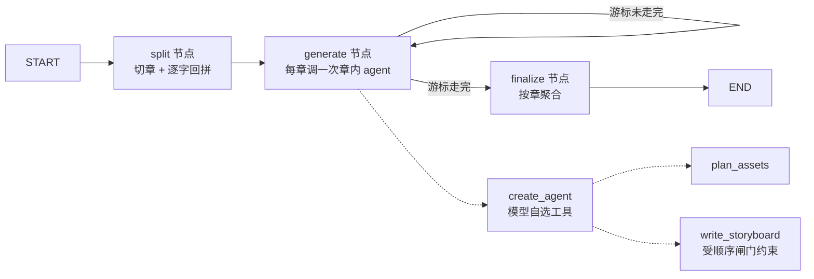
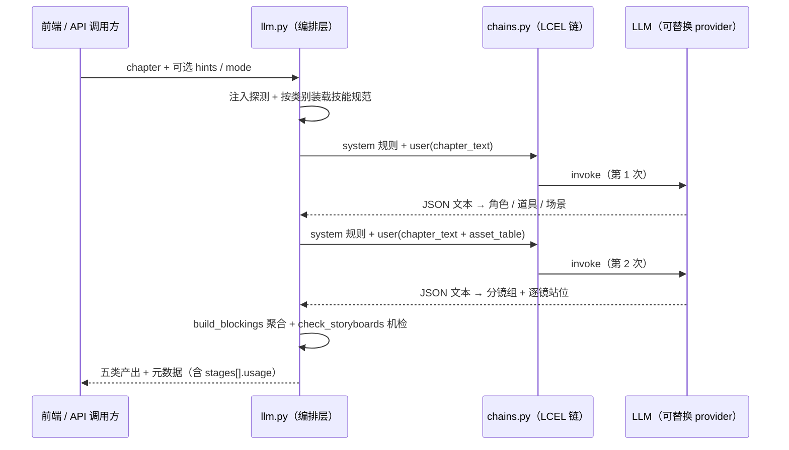

# 后端技术文档

面向开发者：配置、接口契约、调用链、机检规则、技能装载、日志分析与目录结构。产品效果与启动方式见[根 README](../README.md)，项目约定与红线见[AGENTS.md](../AGENTS.md)。

后端当前做一件事：**贴一段小说章节，出五类文生文描述**——角色 / 角色道具 / 场景 / 角色站位 / 分镜组（每组合成 4–15 秒，模型单条上限）。内部按依赖顺序跑两段：先拆视觉设定，再带着已定稿的设定写站位与分镜。文生文走 LangChain 1.x，输出仍是「JSON 文本 + 容错解析 + Pydantic 强校验」。

## 开发环境（uv）

整个仓库只有 `backend/` 一个 Python 项目，环境是 `backend/.venv`，由 uv 单独管理：解释器是 uv 托管的 CPython 3.12.16（不装进系统），`pyvenv.cfg` 里 `include-system-site-packages=false`，site-packages 只有 venv 自己那一处，与系统 Python 和其它项目的 venv 互不相通。版本由 `backend/.python-version` 固定为 3.12。

```bash
cd backend
uv sync --frozen       # 按 uv.lock 精确安装运行依赖 + dev 工具，不重新解析、不改 lock
uv run python -V       # Python 3.12.16，别直接敲 python3
```

项目内的命令一律加 `uv run`（自动用这个 venv，无需手动 activate）：

```bash
uv run uvicorn app.main:app --reload --port 8000
uv run python -m unittest discover -s tests                 # 全量单测，124 个
uv run ruff check app tests                                # 门禁；ruff 已锁在 dev 组，不必再 uvx
uv run python skills/short-drama/scripts/creator_markdown_check.py 剧集/EP001 --project-root .. --partial
```

技能库脚本只依赖标准库，复用同一个 venv 即可，不需要再建一套环境，也不该落到系统 `python3` 上。

- 改依赖：`uv add <包>` / `uv add --dev <包>`，会同步更新 `pyproject.toml` 与 `uv.lock`，两个文件都要提交。
- 换机器或重建：`uv venv --clear --python 3.12 --prompt ai-skit-backend && uv sync --frozen`。`.venv` 已在 `backend/.gitignore` 里，不入库。
- PyCharm 2025.1：项目解释器注册为 `uv (ai_skit)`，指向 `backend/.venv/bin/python`；改完 SDK 配置要重启 IDE 才生效。

## 配置：`backend/.env`（全项目唯一一份）

运行时只读这一份 `.env`。配置类用绝对路径锚定 `backend/`，从仓库根目录或 `backend/` 启动读到的都是同一份。该文件已被忽略、不会入库；新克隆没有它也能跑——所有键都有默认值，空 key 会自动进 mock 模式。

按下面的骨架新建或补全：

```dotenv
# 文生文通道（LangChain）
# provider=openai 走 OpenAI 兼容端点；换成 anthropic / google_genai 等时
# 需另装对应集成包（如 uv add langchain-anthropic），base_url 对非兼容端点无效
LLM_PROVIDER=openai
LLM_BASE_URL=https://api.deepseek.com
LLM_API_KEY=
LLM_MODEL=deepseek-flash
LLM_MOCK=false
# 单次调用：温度 / 超时秒数 / SDK 重试次数 / batch 并发上限
LLM_TEMPERATURE=0.2
LLM_TIMEOUT=120
LLM_MAX_RETRIES=2
LLM_MAX_CONCURRENCY=3
# 日志：默认只记 INFO 到 stderr；分析提示词时把 LEVEL 改成 DEBUG，
# 并给 LOG_DIR 一个目录即可追加 JSON 行日志（自带轮转，保留 7 天）
LLM_LOG_LEVEL=INFO
LLM_LOG_DIR=
LLM_LOG_ROTATE=10 MB
LLM_LOG_RETENTION=7 days
# 技能库目录，留空则用 backend/skills
LLM_SKILLS_DIR=
# 项目侧「技能 → 类别」绑定表，留空则用 backend/skill-bindings.yaml
LLM_SKILLS_BINDINGS=
# 一次注入的技能总字数预算（0 表示用默认 60000）
LLM_SKILLS_BUDGET_CHARS=60000
```

- 未填 key：自动 mock，返回五类假数据，用于跑通前后端联调与演示。
- 填了 key：真实调用 LLM。模型统一由 `init_chat_model` 按 `LLM_PROVIDER` 装配；默认 `openai` 额外带 `LLM_BASE_URL`，覆盖 DeepSeek / 通义 / vLLM 等一切 OpenAI 兼容端点。
- 通道参数默认值：`LLM_TEMPERATURE` 0.2、`LLM_TIMEOUT` 120 秒、`LLM_MAX_RETRIES` 2、`LLM_MAX_CONCURRENCY` 3。改完 `.env` 重启进程生效。

## 接口

| 方法 | 路径 | 说明 |
| --- | --- | --- |
| GET | `/api/health` | 健康检查 |
| GET | `/api/pipeline/skills?categories=characters,scenes` | 技能菜单（仅元数据，供前端勾选） |
| POST | `/api/pipeline/generate-novel` | 多章主路径：小说名 + 若干章 → LangGraph 逐章出五类 |
| POST | `/api/pipeline/generate` | 单章兼容路径，出五类 |
| POST | `/api/pipeline/extract-assets` | 兼容别名（已标记 deprecated） |

请求体只需 `chapter`，其余可选：

```json
{
  "chapter": "林桂芳推开老饭馆的木门……",
  "character_hint": "重点写可跨分镜复用的稳定视觉特征，别写情绪",
  "prop_hint": "只登记后文还会再出现的道具",
  "scene_hint": "光线写具体光源，不要只写氛围词",
  "mode": "auto",
  "target_duration": 15,
  "max_groups": 6,
  "skills": ["short-drama-assets"]
}
```

`mode` 四种：

| 模式 | 调用次数 | 用途 |
| --- | --- | --- |
| `auto`（默认） | 2 | 两段串行，出全五类 |
| `assets_only` | 1 | 只出资产，返修资产时省一半 |
| `per_type` | 3 | 三类并发隔离，用于验证「一起出会不会串味」；不出站位与分镜 |
| `visual_only` | 1 | 带回资产表只重跑分镜；配合 `scene_filter` 做长章分场 |

`scene_filter`（长章必备）：只拆点名的场次，值逐字取资产表里的场景名，如 `["梅洛星花海凉亭"]`；空 = 整章从头顺场推进。实测 4542 字的一章模型自估 22–55 组（约 6–14 分钟），而单次上限 20 组——不分场就只拍得到开头。**不要靠调大 `max_groups` 解决覆盖，要靠 `scene_filter` 分片。**

`target_duration` / `max_groups`：镜长按本场声音与动作时间线推算，3.6 字/秒只作粗估；组只是投产分组，4–15 秒。`max_groups` 是输出体量闸门（默认 6，上限 20），超出时只出前 N 组，响应带 `truncated: true` 与 `total_groups_estimated`。

`skills`：留空按显式声明的类别自动装载；显式点名则按类目分流到对应段，名字不存在返回 `400`。

**错误码只有一处定义**：异常 → 状态码的映射集中在 `app/api/errors.py`，路由里不写 `try/except`。技能名不存在、参数语义问题（章节格式、逐字回拼失败）→ `400`；其余异常 → `500`，响应体统一 `{"detail": "..."}`，堆栈只进日志、不向前端透。

响应是**五类平铺** + 元数据：`characters` / `props` / `scenes` / `blockings` / `storyboards`，加 `prompt_version` / `mode` / `llm_calls` / `hints_used` / `injection_warning` / `skills_*` / `latency_ms` / `stages` / `gate_issues` / `total_groups_estimated` / `truncated`。真实调用时 `stages[]` 每项带 `usage`（`input_tokens` / `output_tokens` / `total_tokens` / `llm_calls` / `llm_errors`），由 LangChain 回调采集，便于按段核算成本。

## 多章编排（LangGraph）

`/generate-novel` 只收两个必填字段：`novel_title`（小说名，独立保留供资产归档）与 `content`（若干章的「标题行 + 正文」）。其余参数与单章路径相同，`mode` 只放开 `auto` / `assets_only` / `per_type`——`visual_only` 依赖单章外部资产表，逐章生成时语义不成立。

```json
{
  "novel_title": "某某小说",
  "content": "第一章：雨夜来客\n正文……\n\n第二章：铜钥匙\n正文……"
}
```

响应是 `chapters[]`，每章一份五类产出与独立元数据（`index` / `title` / `text_chars` / `latency_ms` / `llm_calls` / `agent_calls` / `stages` / `gate_issues` …），顶层另有 `chapter_count` 与各项 `total_*` 汇总。

**成本口径**：`llm_calls` 是生成调用（资产段 / 分镜段），`agent_calls` 是 agent 编排自己的调用（选工具 / 收尾）。真实调用下 auto 一章约 2 次生成 + 3 次编排；两者相加才是总调用数，只看 `llm_calls` 会低估。

**切章不交给模型**：`app/generation/chapters.py` 用行首正则认「第X章/回/节/部/篇/集」，以及「序章/序幕/楔子/引子/终章/尾声/后记/番外」这类惯用节名；标题行允许带 `📖 `、`## ` 等非文字装饰前缀（粘贴场景常见），前缀随切片原样保留。只对源串做切片、不 strip 不归一化；切完做 `"".join(raw) == source` 逐字回拼，失败直接 400。正文里随口提到的「第三章的时候」不是独立标题行，不会被误切。上限 20 章、每章 20,000 字。同一份实现用 `@tool` 注册为 `split_chapters`，后续 agent 节点可直接复用。

**三层编排**（从外到内）：



1. **`graph.py`（外层，LangGraph 1.2.22）**：多章循环，顺序由图边保证。回环条件是 `chapter_index < len(chapters)`，不是模型判断。新增文生图/生视频阶段只加节点与边，不必在每个函数入口写「前置必须存在 XX」的自约束检查。
2. **`agent.py`（章内，`create_agent`）**：模型读章节后自选工具路径。注册两个工具——`plan_assets`（盘三类资产）与 `write_storyboard`（写站位与分镜）；`wrap_tool_call` 中间件守硬依赖：资产表没落地就拒绝分镜调用并把原因回给模型，让它下一轮改调资产工具。这是「模型决定路径，代码守依赖」，不是退回固定链。
3. **`llm.py`（每段实现）**：提示词组装、LCEL 链、Pydantic 校验、机检，完全复用，提示词正文一字未改。

**原文隔离**：章节原文在 `invoke` 时放进 state（`chapter_text`），工具通过 `ToolRuntime.state` 读取。两个工具的 schema 都是空的——模型无法把原文当参数复述或改写。原文确实进入了编排模型的上下文（agent 的固有代价），但它只能影响「调哪个工具」，不进入产物层。任何一章没有工具产出就抛错，绝不返回半成品。

切章失败或任一章生成失败，图直接终止。单章 `/generate` 端点仍是原来的固定两段链，没走 agent，作为对照与兼容路径保留。

## 分层调用链

文生文分三层，提示词正文与输出契约都没变：

| 层 | 文件 | 职责 |
| --- | --- | --- |
| 规则层 | `app/generation/prompts.py` | 两套 system 用 `jinja2.Template` 渲染（只产出字符串，不做消息编排）；`PROMPT_VERSION = v7` 只在正文改动时升版 |
| 通道层 | `app/generation/chains.py` | 模型工厂（`LLM_PROVIDER` 驱动，`lru_cache` 按配置快照复用）、dict → Message 映射、`RunnableConfig`（超时/重试/标签/并发）、`UsageCollector`（token 按阶段归因） |
| 编排层 | `app/generation/llm.py` | 消息组装、两段串行、Pydantic 校验、响应元数据（单章内部）；mock 样例在 `mock_data.py` |
| 章内 agent | `app/generation/agent.py` | `create_agent` + 两个工具 + `wrap_tool_call` 顺序闸门；原文经 state 传递，编排调用计数 |
| 切章层 | `app/generation/chapters.py` | 行首标题识别、确定性切片、逐字回拼校验、`@tool` 注册 |
| 流程层 | `app/generation/graph.py` | StateGraph：split → generate（按章回环，内部进 agent）→ finalize；顺序由图边固定 |

一条 LCEL 链：`dict 消息 → SystemMessage/HumanMessage → ChatModel → 纯文本`，单次走 `invoke`，`per_type` 走 `batch`（并发上限 `LLM_MAX_CONCURRENCY`）。每次调用带 `run_name` / `tags` / `metadata`，接 LangSmith / Langfuse 不需改业务代码。



两次调用不是重复：第一段定名字，第二段引用名字；同一条 LCEL 链复用，只有 messages 与 config 不同。

四条刻意的设计取舍：

1. **章节原文不进模板引擎**。它属不可信输入、逐字零容错，由编排层直接拼进 user；只有项目自己维护的 system 规则走 jinja2。技能正文作为变量值传入，含 `{{ }}` 也不会被二次解析。
2. **不用 `with_structured_output`**。输出契约仍是「JSON 文本 → 容错解析 → Pydantic 强校验」；DeepSeek 等兼容端点对 function calling 支持参差，换契约会让模型直接不可用。
3. **规则能算的不交给模型**。组时长与镜时长自洽、单镜过短、组超 15 秒由 `check_storyboards()` 代码判定，作为 `gate_issues` 回告；镜数不设上下限，避免逼模型注水或砍戏。
4. **技能包可整体替换**。12 个技能遵循 Agent Skills 开放规范，从 GitHub 拿来的目录可直接拷入。自动装载只认显式声明，不靠描述关键词猜。

重试不叠加：模型层 `max_retries` 做一次，链层不再包 `with_retry`（否则指数级放大重试、烧额度）。密钥只以指纹进模型缓存键，不进 `metadata` 与日志。

## 提示词分层

`app/generation/prompts.py` 里的 `PROMPT_VERSION = "v7"`，两套 system 提示词（资产段 / 视觉段）各自两层：

- **system**：角色、硬性规则、技能规范、输入可信度声明、输出契约（稳定不变），由 `jinja2.Template` 渲染。
- **user**：`<chapter_text>` 章节原文（声明为素材、不可信）+ `<user_hints>` 按类别分区的补充要求；第二段额外带 `<asset_table>`。由 `app/generation/llm.py` 直接拼字符串，不经模板引擎。

章节原文逐字放入，不截断不改写；其中若出现注入式语句，只置 `injection_warning`，不拦截也不改字。改提示词正文请升版本号、同步 `tests/unit/prompt_baseline_v7.py` 并重跑全量评测。

技能规范进 system 而不进 user：skill 是项目维护的规则、可信；章节是用户输入、不可信。视觉段的 system 里明确禁止写首尾帧提示词与出片参数——那是 S6 的事，不越界。

`tests/unit/prompt_baseline_v7.py` 是从 git 里迁移前版本提取的提示词基线，`test_langchain_chain.py` 用它逐字对比模板渲染结果，证明迁移只换了载体。

## 五类产出的来源

| 产出 | 来源 | 说明 |
|---|---|---|
| 角色 | 第一段 | 含 `stable_features`（跨场不变的外观特征）、`state`（本集状态/换装）、`voice`（声线）、`prompt`（供 S3 写图片提示词时引用） |
| 角色道具 | 第一段 | 多一个 `owner` 字段：能归属到角色的填角色名，环境陈设留空——这就是「角色道具」的判据 |
| 场景 | 第一段 | `light` 必须写具体光源 |
| 角色站位 | 第二段**聚合** | 由 `build_blockings()` 从 `shots[].blocking` 按组聚合，**不单独生成**，所以永远与分镜一致 |
| 分镜组 | 第二段 | 组号/时长/场景/概要 + 逐镜（镜号/时长/景别/角度/运镜/目的/内容/台词/站位） |

分镜技能里站位写进每镜的「起点/终点」，不单列成表；接口把它按组聚合出来单独展示，只是**视图**，不是第五份独立内容。单独生成会出现两个版本、互相矛盾。

**两段为什么必须串行**：`short-drama-assets` 的 `stage-contract` 写明本阶段「不越界决定单镜临时动作、左右手拿握、构图景别、动作终点或生图/视频提示词」，技能正文也写着「机位走位交由下游」。更硬的理由是一致性：分镜里的角色名、道具名、地点名必须与视觉设定一字不差，唯一可靠的做法是让第二段看到第一段的结果——第一段的资产表作为 `<asset_table>` 进第二段的 user 消息。代价是 2 次调用，换来名字对得上。

## 机检（代码判，不上 LLM）

规则能解决的一律不上 LLM。`check_storyboards()` 就是这条规矩的落点：

| 规则码 | 触发 |
|---|---|
| `shot_sum` | 各镜时长之和 ≠ 组时长（误差 > 0.5s） |
| `group_fragment` | 组时长 < 4s（低于模型单条下限，应并入相邻组） |
| `group_overlong` | 组时长 > 15s（超模型单条上限，应拆组） |
| `empty_group` | 组内没有任何镜头 |
| `shot_too_short` / `shot_overlong` | 单镜 < 1.2s（可拍下限）或 > 15s |

**镜数不判上下限**：分镜技能 `SHT-03` 要求按表演节奏、信息量与连戏决定合并或拆镜，硬套 4–8 镜只会逼模型注水或砍戏。

首版把这些作为 `gate_issues` 回告，**不阻断**。字段级校验也只挡「物理不可能」——组时长上限放到 120s，让 18s 的组变成一条机检提示，而不是让整个请求 500。

`creator_markdown_check.py` 是技能包自带的跨文档机检，文档齐备后应作为交付硬门禁；当前主链路尚未产出那五份文档，因此只用于技能侧校验。

## 技能库

目录与格式兼容 Agent Skills 开放规范，从 GitHub 拿到的 skill 目录可以直接整个拷进来（含 `references/`、`scripts/`、`assets/`、`agents/` 子目录）：

```
skills/<kebab-case-name>/SKILL.md
skills/<kebab-case-name>/references/*.md     # 第三层：按需读取的细则
skills/<kebab-case-name>/agents/openai.yaml  # 可选的展示元数据
```

```markdown
---
name: short-drama-assets       # 必填，小写 kebab-case，目录名建议与之一致
description: 做什么 + 什么时候用  # 必填，出现在 /skills 菜单里
license: MIT                    # 可选，透传到菜单
metadata:                       # 可选
  applies-to: characters,props  # 本项目私有扩展，需要自动装载时才写
  version: "1.0"
---
```

**加载器只强制三件事**：

1. `name` 小写 kebab-case、`description` 非空、正文非空。缺 `applies-to` 不是错误，只是不参与自动装载。
2. **正文不截断**。篇幅控制靠预算：单技能块上限 `MAX_SKILL_BLOCK_CHARS`（32k 字符），一次注入总量 `LLM_SKILLS_BUDGET_CHARS`（默认 60k）。超了整体跳过并在 `skills_skipped` 回告，绝不悄悄砍半截。
3. `name` 与目录名不一致、类别词表不认识，都只记 `notes` 提示，不拒绝加载。

frontmatter 用标准 PyYAML（`yaml.safe_load`）解析，不引自研解析器：`>-` 折叠块、缩进续写、行内列表都是 YAML 语法，交给标准库省掉一整类边界 bug；解析结果统一转 `str`（YAML 会把 `yes/no` 读成 bool、`1.0` 读成 float，而元数据字段都要字符串）。

**references 内联展开**：通用规范是三层渐进披露——frontmatter（菜单）→ SKILL.md 正文（装载）→ `references/*.md`（按需读取）。本项目当前没有文件读取工具，第三层用内联展开降级模拟：解析正文里的 `[文本](references/x.md)`，把目标文件内容包进 `<ref path="...">` 插到正文之后；只认技能目录内的 `.md`，外链与脚本跳过；`..` 一律拒绝；递归两层，超预算保留原链接并说明「未展开」。`skills_refs_expanded` / `skills_refs_skipped` 会回告展开与跳过数量。接上 Function Calling 后，把展开换成真 `read_file` 即可，上层不用改。

**类别与自动装载**：类别词表为 `characters` `props` `scenes` `storyboard` `blocking` `script` `review` `media` `global`。自动装载只认显式声明（`metadata.applies-to` → `skill-bindings.yaml` → `agents/openai.yaml`），不按描述关键词猜。没声明的落到 `manual`，只在显式勾选时装载。目录可用 `LLM_SKILLS_DIR` 覆盖。

**skill-bindings.yaml**：项目侧「技能 → 类别」绑定表，用处是不改技能文件也能让它参与自动装载——外来通用技能不会写本项目的私有字段，把归属声明放在项目侧，技能本身一个字不用动。改完保存即生效（按 mtime 缓存）。

```yaml
short-drama-assets: [characters, props, scenes]      # 第一段：盘资产
short-drama-storyboard: [storyboard, blocking]        # 第二段：站位 + 分镜
```

装载由代码决定，不是模型自己挑：本阶段没有工具调用，模型读不了文件。把 `catalog()` 当成工具菜单给模型，就能变成「模型自己决定加载哪个技能」——骨架不用改，只多一个 `load_skill` 工具。

## 日志与提示词效率分析

`app/observability/logging.py` 用 loguru 做分级日志，两个钩子覆盖全程：

| 钩子 | 位置 | DEBUG / INFO / ERROR 各记什么 |
| --- | --- | --- |
| HTTP 中间件 | `app/observability/middleware.py` | DEBUG 请求进入（method / path / 请求体字节数，取 `content-length`）；INFO 请求完成（status / 耗时 / run_id）；ERROR 未捕获异常 |
| LangChain 回调 | `app/generation/chains.py` 的 `run_config` | DEBUG 每次模型调用起止（stage / mode / prompt_version / model / 字符数 / 输入·输出 token）；ERROR 模型异常 |

一次请求的所有日志带同一个 `run_id`（中间件 set 的 ContextVar，路由复用，回调读取），可用它把「HTTP 请求 → 两段模型调用」串成一条链。`run_id` 也回在 `/generate` 响应里，便于前后端对照。

设 `LLM_LOG_LEVEL=DEBUG`、`LLM_LOG_DIR=logs/`，跑几次请求后看 `logs/ai_skit.log`（JSON 行）：

```bash
LLM_LOG_LEVEL=DEBUG LLM_LOG_DIR=logs uv run uvicorn app.main:app --port 8000
jq -c 'select(.record.extra.event=="llm_end") | .record.extra' logs/ai_skit.log
```

`chars` 是拼接提示词字符数、`chars_each` 是逐条消息长度、`prompt_sha256` 是内容指纹（相同指纹说明两次喂的提示词一致），配合 `input_tokens` / `output_tokens` / `latency_ms` 就能判断「技能注入是不是太占 token」「换提示词后用量有没有涨」。

**脱敏是硬约束**：日志里只有字符数与哈希，没有章节原文、补充要求正文、system 规则全文或密钥。异常消息截 200 字、不记完整堆栈，防止请求体从局部变量漏进日志。默认 `LLM_LOG_LEVEL=INFO` 只输出请求摘要。

直接把 `app.generation.llm` 当库调用（脚本 / 定时任务，不经过 `main.py`）时，需自己调一次 `app.observability.logging.configure_logging()` 才会启用文件 sink；FastAPI 入口已自动调用。

## 目录结构

```
backend/
├── app/
│   ├── main.py              # FastAPI 入口 + CORS + 挂载日志中间件 + 启动日志配置
│   ├── api/                 # HTTP 接口层
│   │   ├── pipeline.py      # skills、generate-novel、generate（+ extract-assets 别名）
│   │   └── errors.py        # 异常 → 状态码的唯一映射（400 / 500）
│   ├── core/                # 核心层：配置与数据契约
│   │   ├── config.py        # 配置（provider / base_url / api_key / model / 调用参数 / 日志 / skills_*）
│   │   └── schemas.py       # Pydantic 契约（五类产出 + Shot/StoryboardGroup + 机检函数）
│   ├── generation/          # 生成层：切章 → 规则 → 链 → 单章 → agent → 多章编排
│   │   ├── prompts.py       # 两套 system 规则层（jinja2.Template）+ 输出契约
│   │   ├── chains.py        # 模型工厂 + LCEL 链 + RunnableConfig + UsageCollector
│   │   ├── llm.py           # 单章编排：消息组装 / 两段串行 / json 解析 / Pydantic 校验
│   │   ├── mock_data.py     # 无密钥联调用的样例产物（不出现在生产路径）
│   │   ├── chapters.py      # 多章切分：行首标题识别 / 逐字回拼 / @tool split_chapters
│   │   ├── agent.py         # 章内 create_agent：两个工具 + 顺序闸门 + 脚本假模型 + 编排调用计数
│   │   └── graph.py         # LangGraph：split → generate（按章回环，内部进 agent）→ finalize
│   ├── observability/       # 可观测层：分级日志、用量提取与请求中间件
│   │   ├── logging.py       # loguru 分级日志 + run_id ContextVar + LoggingCallback（脱敏落盘）
│   │   ├── usage.py         # token 用量提取（响应 stages 与日志共用一份规则）
│   │   └── middleware.py    # HTTP 中间件：绑定 run_id、记录请求起止
│   └── knowledge/           # 知识层：技能包加载
│       └── skills.py        # 扫描 SKILL.md、PyYAML 解析 frontmatter、references 内联展开、预算控制
├── skills/              # 技能库（每个技能一个目录 + SKILL.md + references/）
├── skill-bindings.yaml  # 项目侧「技能 → 类别」绑定表
├── tests/
│   ├── unit/            # 标准库 unittest 单测；prompt_baseline_v7.py 为迁移前提示词基线
│   └── manual/          # 手工试跑脚本（真实调用等，需凭据/网络，不参与 discover）
├── pyproject.toml       # 运行依赖 + dev 组（ruff），uv 项目定义
├── uv.lock              # 精确版本锁；uv sync --frozen 按它安装，不重新解析
├── .python-version      # 固定 Python 3.12
├── .env                 # 唯一配置文件，已 gitignore
└── .venv/               # uv 隔离环境，已 gitignore
```

## 验证与安全

```bash
cd backend
uv run python -m unittest discover -s tests   # 154 tests OK
uv run ruff check app tests                   # All checks passed
```

- 仓库内没有密钥。`backend/.env` 是唯一配置文件，已被忽略且从未进入 git 历史；空 key 自动走 mock。
- `.idea/`、`.workbuddy/`、`frontend/node_modules/` 由仓库根 `.gitignore` 排除，不依赖本机全局配置。
- 章节原文按不可信输入处理：与指令分隔、不进模板引擎、不改字。
- 小说原文可能受版权约束；产物默认仅本地留存。本仓库暂未指定统一许可证；各技能包在 `SKILL.md` frontmatter 中各自声明 `license`。
