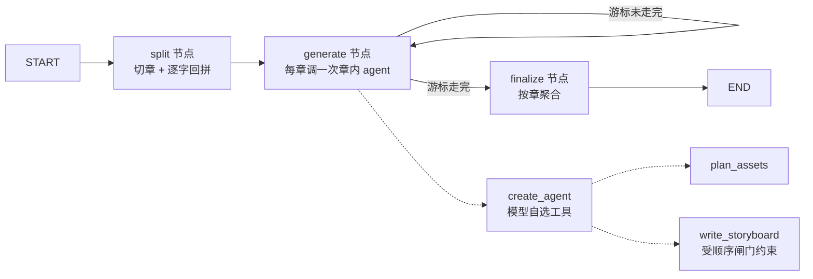
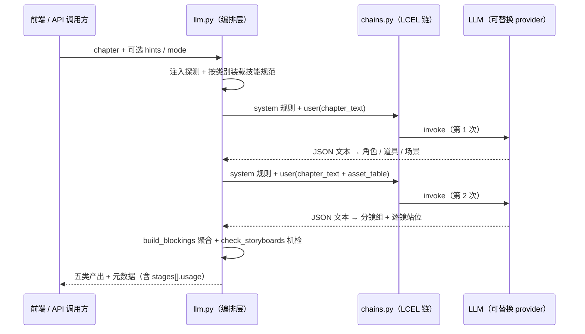

# 后端技术文档

面向开发者：配置、接口契约、调用链、机检规则、技能装载、日志分析与目录结构。产品效果与启动方式见[根 README](../README.md)，项目约定与红线见[AGENTS.md](../AGENTS.md)。

后端当前做一件事：**贴一段小说章节，出五类文生文描述**——角色 / 角色道具 / 场景 / 角色站位 / 分镜组（每组合成 4–15 秒，模型单条上限）。内部按依赖顺序跑两段：先拆视觉设定，再带着已定稿的设定写站位与分镜。文生文走 LangChain 1.x，输出仍是「JSON 文本 + 容错解析 + Pydantic 强校验」。

## 开发环境（uv）

整个仓库只有 `backend/` 一个 Python 项目，环境是 `backend/.venv`，由 uv 单独管理：解释器是 uv 托管的 CPython 3.12.16（不装进系统），`pyvenv.cfg` 里 `include-system-site-packages=false`，site-packages 只有 venv 自己那一处，与系统 Python 和其它项目的 venv 互不相通。版本由 `backend/.python-version` 固定为 3.12。

```bash
cd backend
uv sync --frozen       # 按 uv.lock 精确安装运行依赖 + dev 工具，不重新解析、不改 lock
uv run python -V       # Python 3.12.16，别直接敲 python3
```

项目内的命令一律加 `uv run`（自动用这个 venv，无需手动 activate）：

```bash
uv run uvicorn app.main:app --reload --port 8001
uv run python -m unittest discover -s tests                 # 全量单测，124 个
uv run ruff check app tests                                # 门禁；ruff 已锁在 dev 组，不必再 uvx
uv run python skills/short-drama/scripts/creator_markdown_check.py 剧集/EP001 --project-root .. --partial
```

技能库脚本只依赖标准库，复用同一个 venv 即可，不需要再建一套环境，也不该落到系统 `python3` 上。

- 改依赖：`uv add <包>` / `uv add --dev <包>`，会同步更新 `pyproject.toml` 与 `uv.lock`，两个文件都要提交。
- 换机器或重建：`uv venv --clear --python 3.12 --prompt ai-skit-backend && uv sync --frozen`。`.venv` 已在 `backend/.gitignore` 里，不入库。
- PyCharm 2025.1：项目解释器注册为 `uv (ai_skit)`，指向 `backend/.venv/bin/python`；改完 SDK 配置要重启 IDE 才生效。

## 配置：`backend/.env`（全项目唯一一份）

运行时只读这一份 `.env`。配置类用绝对路径锚定 `backend/`，从仓库根目录或 `backend/` 启动读到的都是同一份。该文件已被忽略、不会入库；新克隆没有它也能跑——所有键都有默认值，空 key 会自动进 mock 模式。

按下面的骨架新建或补全：

```dotenv
# 文生文通道（LangChain）
# provider=openai 走 OpenAI 兼容端点；换成 anthropic / google_genai 等时
# 需另装对应集成包（如 uv add langchain-anthropic），base_url 对非兼容端点无效
LLM_PROVIDER=openai
LLM_BASE_URL=https://api.deepseek.com
LLM_API_KEY=
LLM_MODEL=deepseek-flash
LLM_MOCK=false
# 单次调用：温度 / 超时秒数 / SDK 重试次数 / batch 并发上限
LLM_TEMPERATURE=0.2
LLM_TIMEOUT=120
LLM_MAX_RETRIES=2
LLM_MAX_CONCURRENCY=3
# 日志：默认只记 INFO 到 stderr；分析提示词时把 LEVEL 改成 DEBUG，
# 并给 LOG_DIR 一个目录即可追加 JSON 行日志（自带轮转，保留 7 天）
LLM_LOG_LEVEL=INFO
LLM_LOG_DIR=
LLM_LOG_ROTATE=10 MB
LLM_LOG_RETENTION=7 days
# 技能库目录，留空则用 backend/skills
LLM_SKILLS_DIR=
# 项目侧「技能 → 类别」绑定表，留空则用 backend/skill-bindings.yaml
LLM_SKILLS_BINDINGS=
# 一次注入的技能总字数预算（0 表示用默认 60000）
LLM_SKILLS_BUDGET_CHARS=60000
# 资产归档根目录，留空则用 <仓库>/assets（generate-novel 自动落盘）
LLM_ASSET_ROOT=

# ---- 出图通道（S7 设定图），前缀 MEDIA_，与上面的 LLM_ 互不干扰 ----
# provider 名：fixture（离线假图，默认）/ ark（火山方舟 Seedream）。
# 厂商名只出现在 app/media/providers/ 里，业务层不认识任何厂商。
MEDIA_IMAGE_PROVIDER=fixture
# 模型名或接入点 ID；留空时由 provider 用自己的默认值
MEDIA_IMAGE_MODEL=
# OpenAI 兼容端点；留空时由 provider 用自己的默认地址
MEDIA_IMAGE_BASE_URL=
# 图片通道的 key；留空时回退 ARK_API_KEY，再留空则本地预检直接报错（不核销确认码）
MEDIA_IMAGE_API_KEY=
# 画幅：档位（1K/1.5K/2K/3K/4K）或 "宽x高"（如 2048x1152），两者互斥
MEDIA_IMAGE_SIZE=2K
# 画幅比例，作为技术参数传给 provider，不写进提示词正文
MEDIA_IMAGE_RATIO=16:9
# 水印必须显式关掉：多数厂商默认带水印
MEDIA_IMAGE_WATERMARK=false
# 单次请求超时 / SDK 重试次数 / 批量并发 / 异步轮询间隔与最长等待
MEDIA_TIMEOUT=180
MEDIA_MAX_RETRIES=1
MEDIA_MAX_CONCURRENCY=2
MEDIA_POLL_INTERVAL=5
MEDIA_POLL_TIMEOUT=1800
# 每日最多提交次数，0 表示不限；只拦提交，不拦取回
MEDIA_DAILY_QUOTA=0
# ★ 第二道钱闸门：false 时拒绝装配任何真实厂商，只允许离线 fixture
MEDIA_ALLOW_PAID=false
# 单张图预估成本，仅用于预览展示，不参与计费
MEDIA_COST_PER_IMAGE=0
```

- 未填 key：自动 mock，返回五类假数据，用于跑通前后端联调与演示。
- 填了 key：真实调用 LLM。模型统一由 `init_chat_model` 按 `LLM_PROVIDER` 装配；默认 `openai` 额外带 `LLM_BASE_URL`，覆盖 DeepSeek / 通义 / vLLM 等一切 OpenAI 兼容端点。
- 通道参数默认值：`LLM_TEMPERATURE` 0.2、`LLM_TIMEOUT` 120 秒、`LLM_MAX_RETRIES` 2、`LLM_MAX_CONCURRENCY` 3。改完 `.env` 重启进程生效。
- **出图通道默认不花钱**：`MEDIA_IMAGE_PROVIDER=fixture` + `MEDIA_ALLOW_PAID=false` 时只会生成离线占位图，单测与联调都跑这条路。要真实出图必须同时改两处（`PROVIDER` 换成真实厂商、`ALLOW_PAID=true`），并已填好 key。

## 接口

| 方法 | 路径 | 说明 |
| --- | --- | --- |
| GET | `/api/health` | 健康检查 |
| GET | `/api/pipeline/skills?categories=characters,scenes` | 技能菜单（仅元数据，供前端勾选） |
| POST | `/api/pipeline/generate-novel` | 多章主路径：小说名 + 若干章 → LangGraph 逐章出五类 |
| POST | `/api/pipeline/generate-novel/stream` | 同上，但用 SSE 逐阶段回报进度（前端默认走这条） |
| POST | `/api/pipeline/generate` | 单章兼容路径，出五类 |
| POST | `/api/pipeline/extract-assets` | 兼容别名（已标记 deprecated） |
| GET | `/api/assets/novels` | 资产库：列出已归档小说（目录名 + 三态计数 + 章节数） |
| GET | `/api/assets/novels/{novel}/prompts` | 某小说的提示词条目清单（不含正文） |
| GET | `/api/assets/novels/{novel}/chapters` | 某小说的章节目录与其下文档（`角色站位.md` / `分镜.md`，只列文件名） |
| GET | `/api/assets/novels/{novel}/document?path=` | 读任意归档 Markdown（章节文档只读；`path` 必须落在小说目录内且为 `.md`） |
| GET | `/api/assets/prompts/{id}` | 单条提示词全文 + 模板对照副本 |
| PUT | `/api/assets/prompts/{id}` | 保存编辑：`{"body": "..."}`，结构校验 + 原子写，置 edited |
| POST | `/api/assets/prompts/{id}/approve` | 定稿：edited → approved |
| POST | `/api/assets/prompts/{id}/regenerate` | 采用 `.generated.md` 模板版本，回到 draft |
| POST | `/api/media/preview` | 出图第一步：算账（不花钱）→ 返回指纹、确认码、阻塞项、额度、是否已有同参数成品 |
| POST | `/api/media/generate` | 出图第三步：带确认码提交，SSE 逐张回推（`progress` → `media` → `done`） |
| POST | `/api/media/collect` | 取回已提交的异步任务产物；**绝不重复提交**，所以不受额度限制 |
| GET | `/api/media/jobs` | 任务列表（可按 `novel` / `prompt_id` / `state` 过滤），看状态与失败原因 |
| GET | `/api/media/images?novel=&prompt_id=` | 某小说（或某条目）已出的全部版本 + 当前正文 hash |
| POST | `/api/media/images/{id}/select` | 切换当前选用版：同条目其它版本自动取消选用，旧图不删 |
| GET | `/api/media/images/{id}/sidecar` | 读该版本的技术档案（指纹/模型/参数/seed/成本/耗时） |
| GET | `/api/media/file?novel=&path=` | 读图片本体（`path` 相对小说目录，校验越界与图片后缀） |

请求体只需 `chapter`，其余可选：

```json
{
  "chapter": "林桂芳推开老饭馆的木门……",
  "character_hint": "重点写可跨分镜复用的稳定视觉特征，别写情绪",
  "prop_hint": "只登记后文还会再出现的道具",
  "scene_hint": "光线写具体光源，不要只写氛围词",
  "mode": "auto",
  "target_duration": 15,
  "max_groups": 6,
  "skills": ["short-drama-assets"]
}
```

`mode` 四种：

| 模式 | 调用次数 | 用途 |
| --- | --- | --- |
| `auto`（默认） | 2 | 两段串行，出全五类 |
| `assets_only` | 1 | 只出资产，返修资产时省一半 |
| `per_type` | 3 | 三类并发隔离，用于验证「一起出会不会串味」；不出站位与分镜 |
| `visual_only` | 1 | 带回资产表只重跑分镜；配合 `scene_filter` 做长章分场 |

`scene_filter`（长章必备）：只拆点名的场次，值逐字取资产表里的场景名，如 `["梅洛星花海凉亭"]`；空 = 整章从头顺场推进。实测 4542 字的一章模型自估 22–55 组（约 6–14 分钟），而单次上限 20 组——不分场就只拍得到开头。**不要靠调大 `max_groups` 解决覆盖，要靠 `scene_filter` 分片。**

`target_duration` / `max_groups`：镜长按本场声音与动作时间线推算，3.6 字/秒只作粗估；组只是投产分组，4–15 秒。`max_groups` 是输出体量闸门（默认 6，上限 20），超出时只出前 N 组，响应带 `truncated: true` 与 `total_groups_estimated`。

`skills`：留空按显式声明的类别自动装载；显式点名则按类目分流到对应段，名字不存在返回 `400`。

**错误码只有一处定义**：异常 → 状态码的映射集中在 `app/api/errors.py`，路由里不写 `try/except`。技能名不存在、参数语义问题（章节格式、逐字回拼失败）→ `400`；其余异常 → `500`，响应体统一 `{"detail": "..."}`，堆栈只进日志、不向前端透。

响应是**五类平铺** + 元数据：`characters` / `props` / `scenes` / `blockings` / `storyboards`，加 `prompt_version` / `mode` / `llm_calls` / `hints_used` / `injection_warning` / `skills_*` / `latency_ms` / `stages` / `gate_issues` / `total_groups_estimated` / `truncated`。真实调用时 `stages[]` 每项带 `usage`（`input_tokens` / `output_tokens` / `total_tokens` / `llm_calls` / `llm_errors`），由 LangChain 回调采集，便于按段核算成本。

## 多章编排（LangGraph）

`/generate-novel` 只收两个必填字段：`novel_title`（小说名，独立保留供资产归档）与 `content`（若干章的「标题行 + 正文」）。其余参数与单章路径相同，`mode` 只放开 `auto` / `assets_only` / `per_type`——`visual_only` 依赖单章外部资产表，逐章生成时语义不成立。

```json
{
  "novel_title": "某某小说",
  "content": "第一章：雨夜来客\n正文……\n\n第二章：铜钥匙\n正文……"
}
```

响应是 `chapters[]`，每章一份五类产出与独立元数据（`index` / `title` / `text_chars` / `latency_ms` / `llm_calls` / `agent_calls` / `stages` / `gate_issues` …），顶层另有 `chapter_count` 与各项 `total_*` 汇总。

**生成进度流**：`/generate-novel/stream` 与 `/generate-novel` 请求体、响应内容完全相同，但用 SSE（`text/event-stream`）把阶段进度推给前端。事件按序：

| 事件 | data | 说明 |
| --- | --- | --- |
| `progress` | `{"phase","text","step","total"}` | 若干条，只报阶段不报内容；`total=0` 为不确定态 |
| `done` | 完整 `NovelPipelineResponse` | 一条，与老端点逐字一致（含 `archive`） |
| `error` | `{"message"}` | 生成失败时一条，不直接断连 |

实现要点（`app/generation/graph.py` + `app/api/pipeline.py`）：进度用 LangGraph 原生 `get_stream_writer()` 在图节点内发 `custom` 事件，编译图 `stream(stream_mode=["custom", "values"])` 同时收进度与最终 state；`values` 块不外发。归档阶段在路由层单独报一条。同步图用 starlette `iterate_in_threadpool` 在线程池跑，不阻塞事件循环（进度事件依赖 contextvar，跨线程实测不丢）。老端点走 `invoke`，同一份图节点下进度事件是 no-op，行为不变。阶段文案集中在 `graph.py` 的 `PROGRESS`。前端用 `fetch + ReadableStream` 自解析 SSE（`EventSource` 只支持 GET，POST 带正文不适用）。

**资产归档**：`/generate-novel` 成功后由 `app/generation/archive.py` 自动落盘到 `assets/<小说名>/`（配置键 `LLM_ASSET_ROOT`），响应顶层多一个 `archive` 报告对象：

| 字段 | 含义 |
| --- | --- |
| `root` / `novel_dir` | 归档根与本次小说目录（绝对路径字符串） |
| `files_written` | 本次原子写入的 Markdown 文件数 |
| `characters` / `props` / `scenes` | 跨章去重后的资产条目数 |
| `image_prompt_entries` | 由资产事实模板拼出的 `IMG-...` 条目数（零 LLM 调用） |
| `image_prompts_written` | 本次写到资产目录主文件的提示词文档数；资产事实为空而跳过的条目计入 `errors` |
| `prompts_skipped` | 因 edited/approved 被跳过覆盖、改写对照副本的提示词数 |
| `prompt_draft` / `prompt_edited` / `prompt_approved` | 归档后各状态提示词总数 |
| `chapters` | 落了站位或分镜的章数 |
| `errors` | 局部失败说明；非空表示部分落盘 |

目录结构：`assets/<小说名>/{角色/<角色名>/, 场景/<场景名>/, 道具/<道具名>/, 章节/<章节名>/}`——四个固定中文分类目录，其下才是条目名目录，再往下才是文档。角色 / 场景 / 道具按 `name` 跨章合并、同名只落一份并列出出现章节；道具**一律**落 `道具/<道具名>/`，`owner` 只写进正文「归属角色」、不决定落盘位置（角色目录里只有角色自己的两份文档）；每章只落 `角色站位.md` 与 `分镜.md`（原文不落盘，台词逐字取自原文）。文件名经净化、撞名加序号，重跑幂等覆盖（临时文件 + `os.replace`）。归档失败只在 `archive.errors` 回告并记 WARNING，生成结果照常返回 200——归档是副作用，不是生成的前置闸门。

**S3 图片提示词（零 LLM 拼装）**：`app/generation/image_prompts.py` 是纯函数层——取资产 `prompt`（S2 已把 appearance/stable_features/state 整合成外观事实），按技能包 `sheet-prompt-guide.md` 的六段顺序拼固定版式外壳，产出 `IMG-CHAR-...` / `IMG-SCENE-...` / `IMG-PROP-...` 条目，编号全局连续。与资产文档同目录落 `<名称>-图片提示词.md`，格式含 `- 用途：`、`- 参考：无外部参考` 与 `### 可复制提示词` 引用块。事实逐字取自资产描述，为空时按结构化字段回退、仍为空则跳过并回告 warning；边界：单状态、无外部参考、道具默认无可读字、连戏锁需人工复核，不生成图片、不绑定 `REF-...`。**`llm_calls` 不增加**——这一步不产生任何模型调用。

**资产库：清单与三态**（`app/generation/asset_store.py` + `app/api/assets.py`）：每本小说目录下有 `_manifest.json`，存每条提示词的 `id / img_id / category / asset_name / path / status / body_hash / updated_at`——**正文只在 md 文件里，清单只做索引**，手工改文件仍生效。

- **稳定 id**：`img-<category>-<sha1(category:asset_name) 前 8 位>`；`IMG-CHAR-001` 等只作展示标签，资产顺序变化不会让编辑挂错条目。
- **三态**：`draft → edited → approved`。归档时无条目建 draft、draft 覆盖并刷新 hash、edited/approved 跳过主文件且模板 hash 变化时写 `<名称>-图片提示词.generated.md` 对照副本。`PUT` 保存置 edited，`POST .../approve` 只允许 edited → approved，`POST .../regenerate` 用对照副本覆盖主文件并回 draft。
- **路径安全**：novel 名与 id 经净化 + `resolve()` 越界校验，id 必须命中清单条目，拒绝读 `<asset_root>` 外或清单未登记的文件；非法请求走全局 ValueError → 400 映射。
- **边界**：编辑只动正文，不改 id / category / asset_name；不回填资产 `prompt`（资产是事实源，提示词是派生物）；不做编辑历史与多人锁。前端「资产库」Tab 调这些接口实现查看 / 筛选 / 编辑 / 定稿 / 采用模板版本。

**章节不进清单**：章节没有 `IMG-...` 编号、没有三态，所以不写进 `_manifest.json`。`asset_store.list_chapters` 直接读 `章节/<章节标题>/` 目录，返回标题目录名 + 其下 `.md` 文档（名称 / 相对路径 / 字节数 / mtime）；`read_document` 读任意归档 Markdown 供只读查看，`path` 同样经 `resolve()` 校验必须落在小说目录内且只接受 `.md`。前端把章节与提示词拼成同一棵树展示，章节行标「只读」、不提供编辑与定稿。小说列表的 `chapters` 计数也按磁盘统计。

**成本口径**：`llm_calls` 是生成调用（资产段 / 分镜段），`agent_calls` 是 agent 编排自己的调用（选工具 / 收尾）。真实调用下 auto 一章约 2 次生成 + 3 次编排；两者相加才是总调用数，只看 `llm_calls` 会低估。

**切章不交给模型**：`app/generation/chapters.py` 用行首正则认「第X章/回/节/部/篇/集」，以及「序章/序幕/楔子/引子/终章/尾声/后记/番外」这类惯用节名；标题行允许带 `📖 `、`## ` 等非文字装饰前缀（粘贴场景常见），前缀随切片原样保留。只对源串做切片、不 strip 不归一化；切完做 `"".join(raw) == source` 逐字回拼，失败直接 400。正文里随口提到的「第三章的时候」不是独立标题行，不会被误切。上限 20 章、每章 20,000 字。同一份实现用 `@tool` 注册为 `split_chapters`，后续 agent 节点可直接复用。

**三层编排**（从外到内）：



1. **`graph.py`（外层，LangGraph 1.2.22）**：多章循环，顺序由图边保证。回环条件是 `chapter_index < len(chapters)`，不是模型判断。新增文生图/生视频阶段只加节点与边，不必在每个函数入口写「前置必须存在 XX」的自约束检查。
2. **`agent.py`（章内，`create_agent`）**：模型读章节后自选工具路径。注册两个工具——`plan_assets`（盘三类资产）与 `write_storyboard`（写站位与分镜）；`wrap_tool_call` 中间件守硬依赖：资产表没落地就拒绝分镜调用并把原因回给模型，让它下一轮改调资产工具。这是「模型决定路径，代码守依赖」，不是退回固定链。
3. **`llm.py`（每段实现）**：提示词组装、LCEL 链、Pydantic 校验、机检，完全复用，提示词正文一字未改。

**原文隔离**：章节原文在 `invoke` 时放进 state（`chapter_text`），工具通过 `ToolRuntime.state` 读取。两个工具的 schema 都是空的——模型无法把原文当参数复述或改写。原文确实进入了编排模型的上下文（agent 的固有代价），但它只能影响「调哪个工具」，不进入产物层。任何一章没有工具产出就抛错，绝不返回半成品。

切章失败或任一章生成失败，图直接终止。单章 `/generate` 端点仍是原来的固定两段链，没走 agent，作为对照与兼容路径保留。

## 出图通道（S7 设定图，`app/media/`）

把 `图片提示词.md` 的 `### 可复制提示词` 正文变成真图。分四层，**业务层不认识任何厂商**：

| 层 | 文件 | 职责 |
| --- | --- | --- |
| 端口层 | `contract.py` | `MediaProvider` 协议（`generate` / `collect`）、`MediaRequest` / `Capabilities` / `MediaResult`、`MediaError` 与错误分类、`sanitize_detail` |
| 配置层 | `settings.py` | `MEDIA_*` 独立前缀；provider 名、模型名、地址都是字符串，默认值是离线实现 |
| 任务层 | `jobs.py` | 指纹计算、确认码、`MediaJob` 状态机、`_media/` 落盘、日额度账本 |
| 落盘层 | `store.py` | `图片/<条目>-vN.png` + `-vN.json` sidecar、版本号只增不减、`manifest.images[]` 回写 |
| 服务层 | `service.py` | `preview` / `generate_stream` / `collect` 三个业务动作，串起上面四层 |
| 厂商层 | `providers/` | `fixture`（离线假图，标准库画 PNG）/ `ark`（真实，OpenAI 兼容端点）+ `registry.py` |

**为什么不用 LangChain 的模型抽象**：LangChain 1.x 的 `BaseChatModel` / `Embeddings` 只覆盖文本与向量，没有通用的图片模型接口。硬套只会把图片参数塞进 chat 消息里，反而失去类型检查。所以通道层只用 `openai` SDK 做 HTTP（连接池、超时、重试都是它的），外面包一层极薄的 provider 端口。

**为什么没有 agent 层**：出图没有决策点——拿到提示词就调一次 provider，没有「先调 A 还是先调 B」的判断。套 `create_agent` 会白烧一次 LLM 调用，套 StateGraph 也只是把线性三步画成图，而确认码是**人**的动作、不是图的状态转移。批量编排与 `interrupt()` 留到多条目批量阶段。

### 三步协议（对应技能包的 prepare / confirm / run）

| 步 | 接口 | 花钱 | 做什么 |
| --- | --- | --- | --- |
| ① 预览 | `POST /api/media/preview` | 否 | 读提示词正文 → 算指纹 → 查缓存 → 查额度 → 回确认码与阻塞项 |
| ② 确认 | 前端把确认码原样回传 | 否 | 用户看过指纹、成本、额度、水印警告后点确认 |
| ③ 提交 | `POST /api/media/generate` | 是 | 重新校验指纹（防止预览后改过提示词）→ 核销确认码 → 调 provider → 落盘 |

- **指纹**：`sha256(提示词正文 hash + provider + model + size + ratio + seed + 参考图 hash)`。改提示词、换模型、改画幅、换 seed 都会变。
- **确认码**：`CONFIRM <job_id> <fingerprint[:12]>`。提交时服务端重算指纹比对，不一致就拒绝（`400`），强制重新预览。
- **`submitted` 语义**：provider 明确告知「请求没发出去」（缺 key、缺模型、本地预检失败）→ `submitted=false`，**确认码保留**，修好配置可直接重试；请求已发出（含超时、限流）→ `submitted=true`，**确认码核销**，重试须重新确认——因为远端可能已经出图并计费。
- **幂等**：同指纹已成功出图，`generate` 直接返回那张图（`cached: true`），一次都不提交。
- **额度**：`MEDIA_DAILY_QUOTA` 只拦提交、不拦 `collect`（取回已有产物不该被额度卡）。

### 失败语义与错误分类

`MediaError.category` 固定八档（`contract.ErrorCategory`，闭集，不接受任意字符串）：
`invalid_request` / `auth` / `rate_limit` / `quota` / `timeout` / `content_policy` / `network` / `provider_error`。

`retryable` 由各 provider 按错误类型判定，不是按 category 机械映射：`rate_limit` / `timeout` / `network` 为真；
另外 **HTTP 5xx 也判可重试**（`status >= 500`），4xx 与内容策略拒绝一律不可重试。

`detail` 经 `sanitize_detail` 脱敏：抹掉 `sk-` / `Bearer` / `ark-` 形态的密钥、URL、绝对路径，截到 **400** 字
（`MAX_DETAIL_CHARS`；留这么长是为了保住厂商报文末尾的处理指引，例如方舟 429 提示去管理页关闭安全体验模式）。
**原始异常只进日志，不向前端透**。

### 产物与版本

```
assets/<小说名>/<分类目录>/<条目名>/
├── <条目名>-图片提示词.md      # 输入（逐字取 ### 可复制提示词 的引用块）
└── 图片/
    ├── <条目名>-v1.png          # 产物本体：事实源
    ├── <条目名>-v1.json         # sidecar：指纹/模型/参数/seed/成本/耗时/源提示词 hash
    ├── <条目名>-v2.png
    └── <条目名>-v2.json
```

- **版本号只增不减**：`next_version` 取该条目已有最大版本 +1，永不复用。旧版留着能退，不静默清理。
- **sidecar 是档案，不是事实源**：图没了 sidecar 无意义；手工换图不影响出图逻辑。
- **`manifest.images[]`** 只是索引（id / 路径 / 版本 / 是否选用 / 指纹），清单丢了可从 `图片/` 目录重建。
- **`_media/jobs/<job_id>.json`** 存任务状态（每本小说一套）。删掉只丢任务历史，不影响已出的图。
- **额度账本 `assets/_media_ledger.json`** 在资产根、跨小说一份：日额度是「这台机器今天最多提交几次」的全局闸门，不按小说分账；保留最近 60 天。

### 换厂商的验收口径

```bash
grep -rn "volcengine\|doubao\|seedream\|minimax" backend/app/ | grep -v "app/media/providers/"
# 期望：零命中（配置别名 ARK_API_KEY 除外）
```

满足这条，就说明「换厂商只改 `.env` 的 `MEDIA_IMAGE_PROVIDER`」不是口号。新增厂商只需在 `providers/` 加一个文件、在 `registry.py` 注册，业务层零改动。

## 分层调用链

文生文分三层，提示词正文与输出契约都没变：

| 层 | 文件 | 职责 |
| --- | --- | --- |
| 规则层 | `app/generation/prompts.py` | 两套 system 用 `jinja2.Template` 渲染（只产出字符串，不做消息编排）；`PROMPT_VERSION = v7` 只在正文改动时升版 |
| 通道层 | `app/generation/chains.py` | 模型工厂（`LLM_PROVIDER` 驱动，`lru_cache` 按配置快照复用）、dict → Message 映射、`RunnableConfig`（超时/重试/标签/并发）、`UsageCollector`（token 按阶段归因） |
| 编排层 | `app/generation/llm.py` | 消息组装、两段串行、Pydantic 校验、响应元数据（单章内部）；mock 样例在 `mock_data.py` |
| 章内 agent | `app/generation/agent.py` | `create_agent` + 两个工具 + `wrap_tool_call` 顺序闸门；原文经 state 传递，编排调用计数 |
| 切章层 | `app/generation/chapters.py` | 行首标题识别、确定性切片、逐字回拼校验、`@tool` 注册 |
| 流程层 | `app/generation/graph.py` | StateGraph：split → generate（按章回环，内部进 agent）→ finalize；顺序由图边固定 |

一条 LCEL 链：`dict 消息 → SystemMessage/HumanMessage → ChatModel → 纯文本`，单次走 `invoke`，`per_type` 走 `batch`（并发上限 `LLM_MAX_CONCURRENCY`）。每次调用带 `run_name` / `tags` / `metadata`，接 LangSmith / Langfuse 不需改业务代码。



两次调用不是重复：第一段定名字，第二段引用名字；同一条 LCEL 链复用，只有 messages 与 config 不同。

四条刻意的设计取舍：

1. **章节原文不进模板引擎**。它属不可信输入、逐字零容错，由编排层直接拼进 user；只有项目自己维护的 system 规则走 jinja2。技能正文作为变量值传入，含 `{{ }}` 也不会被二次解析。
2. **不用 `with_structured_output`**。输出契约仍是「JSON 文本 → 容错解析 → Pydantic 强校验」；DeepSeek 等兼容端点对 function calling 支持参差，换契约会让模型直接不可用。
3. **规则能算的不交给模型**。组时长与镜时长自洽、单镜过短、组超 15 秒由 `check_storyboards()` 代码判定，作为 `gate_issues` 回告；镜数不设上下限，避免逼模型注水或砍戏。
4. **技能包可整体替换**。12 个技能遵循 Agent Skills 开放规范，从 GitHub 拿来的目录可直接拷入。自动装载只认显式声明，不靠描述关键词猜。

重试不叠加：模型层 `max_retries` 做一次，链层不再包 `with_retry`（否则指数级放大重试、烧额度）。密钥只以指纹进模型缓存键，不进 `metadata` 与日志。

## 提示词分层

`app/generation/prompts.py` 里的 `PROMPT_VERSION = "v7"`，两套 system 提示词（资产段 / 视觉段）各自两层：

- **system**：角色、硬性规则、技能规范、输入可信度声明、输出契约（稳定不变），由 `jinja2.Template` 渲染。
- **user**：`<chapter_text>` 章节原文（声明为素材、不可信）+ `<user_hints>` 按类别分区的补充要求；第二段额外带 `<asset_table>`。由 `app/generation/llm.py` 直接拼字符串，不经模板引擎。

章节原文逐字放入，不截断不改写；其中若出现注入式语句，只置 `injection_warning`，不拦截也不改字。改提示词正文请升版本号、同步 `tests/unit/prompt_baseline_v7.py` 并重跑全量评测。

技能规范进 system 而不进 user：skill 是项目维护的规则、可信；章节是用户输入、不可信。视觉段的 system 里明确禁止写首尾帧提示词与出片参数——那是 S6 的事，不越界。

`tests/unit/prompt_baseline_v7.py` 是从 git 里迁移前版本提取的提示词基线，`test_langchain_chain.py` 用它逐字对比模板渲染结果，证明迁移只换了载体。

## 五类产出的来源

| 产出 | 来源 | 说明 |
|---|---|---|
| 角色 | 第一段 | 含 `stable_features`（跨场不变的外观特征）、`state`（本集状态/换装）、`voice`（声线）、`prompt`（供 S3 写图片提示词时引用） |
| 角色道具 | 第一段 | 多一个 `owner` 字段：能归属到角色的填角色名，环境陈设留空——这就是「角色道具」的判据 |
| 场景 | 第一段 | `light` 必须写具体光源 |
| 角色站位 | 第二段**聚合** | 由 `build_blockings()` 从 `shots[].blocking` 按组聚合，**不单独生成**，所以永远与分镜一致 |
| 分镜组 | 第二段 | 组号/时长/场景/概要 + 逐镜（镜号/时长/景别/角度/运镜/目的/内容/台词/站位） |

分镜技能里站位写进每镜的「起点/终点」，不单列成表；接口把它按组聚合出来单独展示，只是**视图**，不是第五份独立内容。单独生成会出现两个版本、互相矛盾。

**两段为什么必须串行**：`short-drama-assets` 的 `stage-contract` 写明本阶段「不越界决定单镜临时动作、左右手拿握、构图景别、动作终点或生图/视频提示词」，技能正文也写着「机位走位交由下游」。更硬的理由是一致性：分镜里的角色名、道具名、地点名必须与视觉设定一字不差，唯一可靠的做法是让第二段看到第一段的结果——第一段的资产表作为 `<asset_table>` 进第二段的 user 消息。代价是 2 次调用，换来名字对得上。

## 机检（代码判，不上 LLM）

规则能解决的一律不上 LLM。`check_storyboards()` 就是这条规矩的落点：

| 规则码 | 触发 |
|---|---|
| `shot_sum` | 各镜时长之和 ≠ 组时长（误差 > 0.5s） |
| `group_fragment` | 组时长 < 4s（低于模型单条下限，应并入相邻组） |
| `group_overlong` | 组时长 > 15s（超模型单条上限，应拆组） |
| `empty_group` | 组内没有任何镜头 |
| `shot_too_short` / `shot_overlong` | 单镜 < 1.2s（可拍下限）或 > 15s |

**镜数不判上下限**：分镜技能 `SHT-03` 要求按表演节奏、信息量与连戏决定合并或拆镜，硬套 4–8 镜只会逼模型注水或砍戏。

首版把这些作为 `gate_issues` 回告，**不阻断**。字段级校验也只挡「物理不可能」——组时长上限放到 120s，让 18s 的组变成一条机检提示，而不是让整个请求 500。

`creator_markdown_check.py` 是技能包自带的跨文档机检，文档齐备后应作为交付硬门禁；当前主链路尚未产出那五份文档，因此只用于技能侧校验。

## 技能库

目录与格式兼容 Agent Skills 开放规范，从 GitHub 拿到的 skill 目录可以直接整个拷进来（含 `references/`、`scripts/`、`assets/`、`agents/` 子目录）：

```
skills/<kebab-case-name>/SKILL.md
skills/<kebab-case-name>/references/*.md     # 第三层：按需读取的细则
skills/<kebab-case-name>/agents/openai.yaml  # 可选的展示元数据
```

```markdown
---
name: short-drama-assets       # 必填，小写 kebab-case，目录名建议与之一致
description: 做什么 + 什么时候用  # 必填，出现在 /skills 菜单里
license: MIT                    # 可选，透传到菜单
metadata:                       # 可选
  applies-to: characters,props  # 本项目私有扩展，需要自动装载时才写
  version: "1.0"
---
```

**加载器只强制三件事**：

1. `name` 小写 kebab-case、`description` 非空、正文非空。缺 `applies-to` 不是错误，只是不参与自动装载。
2. **正文不截断**。篇幅控制靠预算：单技能块上限 `MAX_SKILL_BLOCK_CHARS`（32k 字符），一次注入总量 `LLM_SKILLS_BUDGET_CHARS`（默认 60k）。超了整体跳过并在 `skills_skipped` 回告，绝不悄悄砍半截。
3. `name` 与目录名不一致、类别词表不认识，都只记 `notes` 提示，不拒绝加载。

frontmatter 用标准 PyYAML（`yaml.safe_load`）解析，不引自研解析器：`>-` 折叠块、缩进续写、行内列表都是 YAML 语法，交给标准库省掉一整类边界 bug；解析结果统一转 `str`（YAML 会把 `yes/no` 读成 bool、`1.0` 读成 float，而元数据字段都要字符串）。

**references 内联展开**：通用规范是三层渐进披露——frontmatter（菜单）→ SKILL.md 正文（装载）→ `references/*.md`（按需读取）。本项目当前没有文件读取工具，第三层用内联展开降级模拟：解析正文里的 `[文本](references/x.md)`，把目标文件内容包进 `<ref path="...">` 插到正文之后；只认技能目录内的 `.md`，外链与脚本跳过；`..` 一律拒绝；递归两层，超预算保留原链接并说明「未展开」。`skills_refs_expanded` / `skills_refs_skipped` 会回告展开与跳过数量。接上 Function Calling 后，把展开换成真 `read_file` 即可，上层不用改。

**类别与自动装载**：类别词表为 `characters` `props` `scenes` `storyboard` `blocking` `script` `review` `media` `global`。自动装载只认显式声明（`metadata.applies-to` → `skill-bindings.yaml` → `agents/openai.yaml`），不按描述关键词猜。没声明的落到 `manual`，只在显式勾选时装载。目录可用 `LLM_SKILLS_DIR` 覆盖。

**skill-bindings.yaml**：项目侧「技能 → 类别」绑定表，用处是不改技能文件也能让它参与自动装载——外来通用技能不会写本项目的私有字段，把归属声明放在项目侧，技能本身一个字不用动。改完保存即生效（按 mtime 缓存）。

```yaml
short-drama-assets: [characters, props, scenes]      # 第一段：盘资产
short-drama-storyboard: [storyboard, blocking]        # 第二段：站位 + 分镜
```

装载由代码决定，不是模型自己挑：本阶段没有工具调用，模型读不了文件。把 `catalog()` 当成工具菜单给模型，就能变成「模型自己决定加载哪个技能」——骨架不用改，只多一个 `load_skill` 工具。

## 日志与提示词效率分析

`app/observability/logging.py` 用 loguru 做分级日志，两个钩子覆盖全程：

| 钩子 | 位置 | DEBUG / INFO / ERROR 各记什么 |
| --- | --- | --- |
| HTTP 中间件 | `app/observability/middleware.py` | DEBUG 请求进入（method / path / 请求体字节数，取 `content-length`）；INFO 请求完成（status / 耗时 / run_id）；ERROR 未捕获异常 |
| LangChain 回调 | `app/generation/chains.py` 的 `run_config` | DEBUG 每次模型调用起止（stage / mode / prompt_version / model / 字符数 / 输入·输出 token）；ERROR 模型异常 |

一次请求的所有日志带同一个 `run_id`（中间件 set 的 ContextVar，路由复用，回调读取），可用它把「HTTP 请求 → 两段模型调用」串成一条链。`run_id` 也回在 `/generate` 响应里，便于前后端对照。

设 `LLM_LOG_LEVEL=DEBUG`、`LLM_LOG_DIR=logs/`，跑几次请求后看 `logs/ai_skit.log`（JSON 行）：

```bash
LLM_LOG_LEVEL=DEBUG LLM_LOG_DIR=logs uv run uvicorn app.main:app --port 8001
jq -c 'select(.record.extra.event=="llm_end") | .record.extra' logs/ai_skit.log
```

`chars` 是拼接提示词字符数、`chars_each` 是逐条消息长度、`prompt_sha256` 是内容指纹（相同指纹说明两次喂的提示词一致），配合 `input_tokens` / `output_tokens` / `latency_ms` 就能判断「技能注入是不是太占 token」「换提示词后用量有没有涨」。

**脱敏是硬约束**：日志里只有字符数与哈希，没有章节原文、补充要求正文、system 规则全文或密钥。异常消息截 200 字、不记完整堆栈，防止请求体从局部变量漏进日志。默认 `LLM_LOG_LEVEL=INFO` 只输出请求摘要。

直接把 `app.generation.llm` 当库调用（脚本 / 定时任务，不经过 `main.py`）时，需自己调一次 `app.observability.logging.configure_logging()` 才会启用文件 sink；FastAPI 入口已自动调用。

## 目录结构

```
backend/
├── app/
│   ├── main.py              # FastAPI 入口 + CORS + 挂载日志中间件 + 启动日志配置
│   ├── api/                 # HTTP 接口层
│   │   ├── pipeline.py      # skills、generate-novel（+ /stream SSE 进度）、generate（+ extract-assets 别名）
│   │   ├── assets.py        # 资产库读写：列小说/提示词/读单条/保存/定稿/重渲染
│   │   └── errors.py        # 异常 → 状态码的唯一映射（400 / 500）
│   ├── core/                # 核心层：配置与数据契约
│   │   ├── config.py        # 配置（provider / base_url / api_key / model / 调用参数 / 日志 / skills_*）
│   │   └── schemas.py       # Pydantic 契约（五类产出 + Shot/StoryboardGroup + 资产库清单 + 机检函数）
│   ├── generation/          # 生成层：切章 → 规则 → 链 → 单章 → agent → 多章编排
│   │   ├── prompts.py       # 两套 system 规则层（jinja2.Template）+ 输出契约
│   │   ├── chains.py        # 模型工厂 + LCEL 链 + RunnableConfig + UsageCollector
│   │   ├── llm.py           # 单章编排：消息组装 / 两段串行 / json 解析 / Pydantic 校验
│   │   ├── mock_data.py     # 无密钥联调用的样例产物（不出现在生产路径）
│   │   ├── chapters.py      # 多章切分：行首标题识别 / 逐字回拼 / @tool split_chapters
│   │   ├── agent.py         # 章内 create_agent：两个工具 + 顺序闸门 + 脚本假模型 + 编排调用计数
│   │   ├── graph.py         # LangGraph：split → generate（按章回环，内部进 agent）→ finalize；get_stream_writer 发进度；stream_novel_pipeline 流式入口
│   │   ├── archive.py       # 资产归档：final → assets/<小说名>/ 目录树（Markdown、跨章去重、原子写、尊重三态）
│   │   ├── image_prompts.py # S3 图片提示词：资产事实 + 固定版式模板 → IMG-...（纯函数、零 LLM）
│   │   └── asset_store.py   # 资产库清单：_manifest.json 读写、稳定 id、三态迁移、路径安全
│   ├── media/               # 出图层（S7 设定图）：端口 + provider + 任务层
│   │   ├── contract.py      # MediaProvider 端口、请求/能力/结果契约、错误分类与脱敏
│   │   ├── settings.py      # MEDIA_* 配置（独立前缀，不认识具体厂商）
│   │   ├── jobs.py          # 指纹、确认码、任务状态机、日额度账本（_media/）
│   │   ├── store.py         # 图片落盘：图片/<条目>-vN.png + sidecar + manifest.images[]
│   │   ├── service.py       # preview / generate_stream / collect 三步协议
│   │   └── providers/       # 唯一允许出现厂商名的地方
│   │       ├── fixture.py   # 离线假图（标准库 zlib 画 PNG，零依赖）
│   │       ├── ark_seedream.py # 真实：OpenAI 兼容端点 + 载荷编译 + 错误映射
│   │       └── registry.py  # 按名字装配；allow_paid=false 时拒绝真实厂商
│   ├── observability/       # 可观测层：分级日志、用量提取与请求中间件
│   │   ├── logging.py       # loguru 分级日志 + run_id ContextVar + LoggingCallback（脱敏落盘）
│   │   ├── usage.py         # token 用量提取（响应 stages 与日志共用一份规则）
│   │   └── middleware.py    # HTTP 中间件：绑定 run_id、记录请求起止
│   └── knowledge/           # 知识层：技能包加载
│       └── skills.py        # 扫描 SKILL.md、PyYAML 解析 frontmatter、references 内联展开、预算控制
├── skills/              # 技能库（每个技能一个目录 + SKILL.md + references/）
├── skill-bindings.yaml  # 项目侧「技能 → 类别」绑定表
├── tests/
│   ├── unit/            # 标准库 unittest 单测；prompt_baseline_v7.py 为迁移前提示词基线
│   └── manual/          # 手工试跑脚本（真实调用等，需凭据/网络，不参与 discover）
├── pyproject.toml       # 运行依赖 + dev 组（ruff），uv 项目定义
├── uv.lock              # 精确版本锁；uv sync --frozen 按它安装，不重新解析
├── .python-version      # 固定 Python 3.12
├── .env                 # 唯一配置文件，已 gitignore
└── .venv/               # uv 隔离环境，已 gitignore
```

## 验证与安全

```bash
cd backend
uv run python -m unittest discover -s tests   # 248 tests OK
uv run ruff check app tests                   # All checks passed
```

- 仓库内没有密钥。`backend/.env` 是唯一配置文件，已被忽略且从未进入 git 历史；空 key 自动走 mock。
- `.idea/`、`.workbuddy/`、`frontend/node_modules/` 由仓库根 `.gitignore` 排除，不依赖本机全局配置。
- 章节原文按不可信输入处理：与指令分隔、不进模板引擎、不改字。
- 小说原文可能受版权约束；产物默认仅本地留存。本仓库暂未指定统一许可证；各技能包在 `SKILL.md` frontmatter 中各自声明 `license`。
